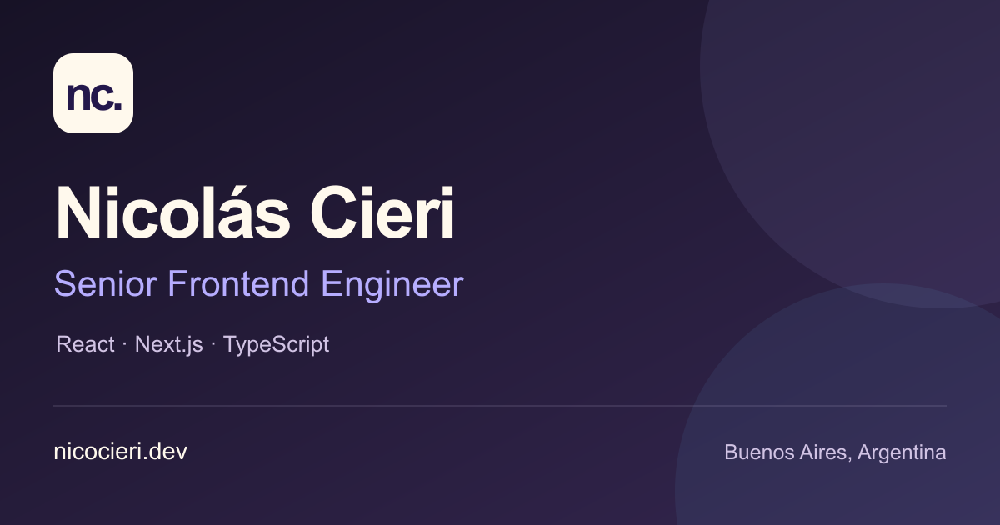

# Nicolás Cieri — Portfolio

Personal portfolio of Nicolás Cieri, Senior Software Engineer and Tech Lead. Built around interactive demonstrations of interface engineering for ticketing, seat selection, operational tools, airport workflows and e-commerce.

[Visit the portfolio](https://nicocieri.dev) · [Español](https://nicocieri.dev/es)



The demonstrations are original fictional concepts. They do not reproduce employer products or process real bookings, payments or passenger data.

## Built with

- Next.js App Router and React
- TypeScript and Tailwind CSS
- HTML, CSS and SVG demonstrations with custom animation hooks
- Statically prerendered pages in English and Spanish

Desktop demos advance with scrolling. Mobile demos play automatically while visible and pause when offscreen or when the browser tab is hidden. Reduced-motion preferences are respected, and mobile layouts use simpler visual effects.

## Run locally

Use a Node.js version supported by the installed Next.js release and npm.

```sh
npm ci
npm run dev
```

Open [localhost:3000](http://localhost:3000). No environment variables are required for the current site; contact uses direct email and LinkedIn links.

## Checks and production build

```sh
npm run lint
npm run typecheck
npm test
npm run build
npm start
```

Tests use Node’s built-in test runner and cover scene lifecycles, playback, reduced motion, localized announcements and metadata. Production output is generated in `.next/` for a Next.js-compatible host such as Vercel.

## Project structure

- `src/app/` — routes, layouts and metadata
- `src/components/` — page sections, illustrated demos and shared UI
- `src/hooks/` — animation and browser interaction logic
- `src/i18n/` — English and Spanish content
- `src/styles/tokens.css` — shared design tokens
- `public/` — images and brand assets
- `tests/` — focused behavior checks

See [architecture and maintenance](docs/architecture.md) for animation details, accessibility considerations, brand asset generation and the optional contact form.

## License

Source code is available under the [MIT License](LICENSE).

Personal photographs, name, logos and personal branding assets are excluded from that license; all rights to those assets are reserved. Replace them with your own when adapting the project. The MIT License does not grant trademark or personality rights.
